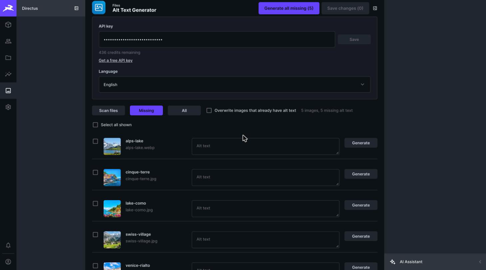
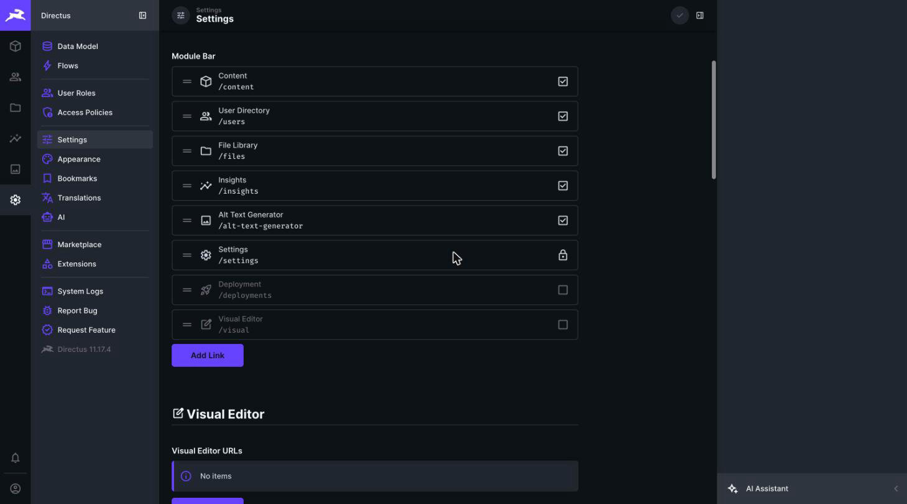
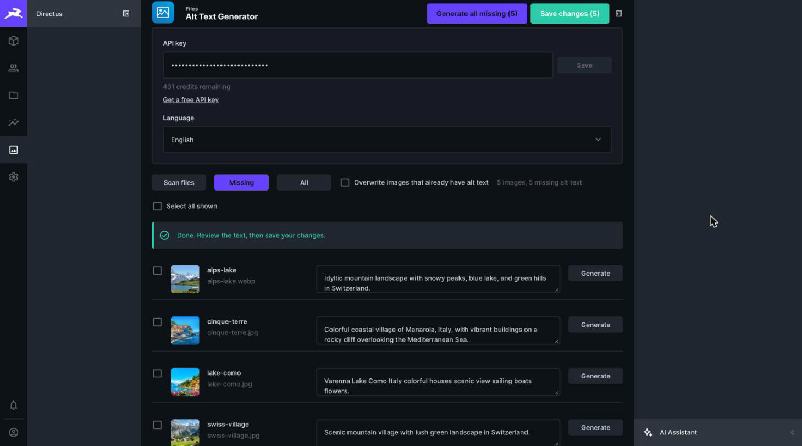
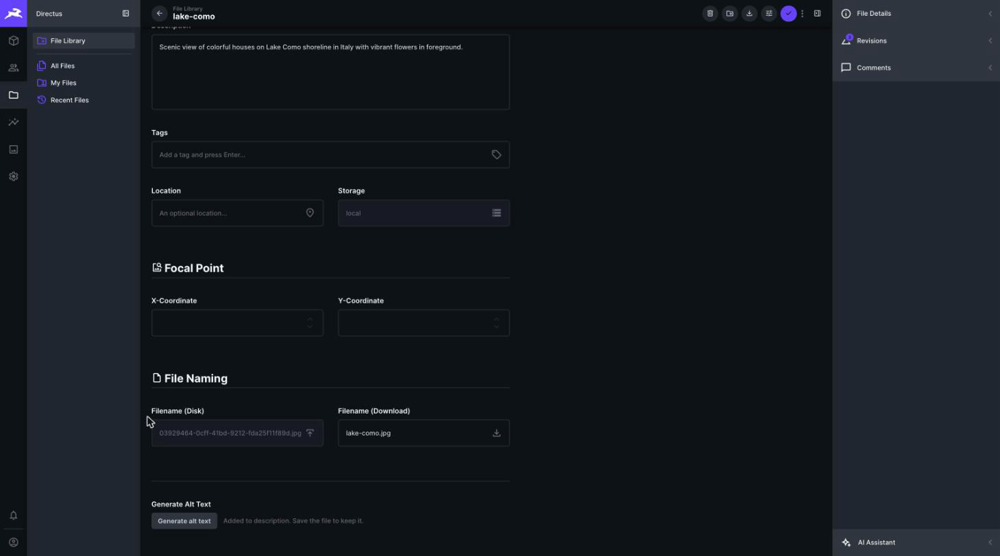

# Alt Text Generator for Directus


Generate SEO-friendly alt text for the images in your Directus file library. Write it for one image, for a selection, or for every image that is missing it, in 131 languages.

The alt text is saved in each file's **Description** field, so it is ready to use as the `alt` attribute of your images.

[Get a free API key](https://alttextgeneratorai.com/dashboard)

## What you get

- **Bulk screen.** A new **Alt Text Generator** module scans your files, shows thumbnails, lists the images that have no alt text, and generates it for all of them or only the ones you tick.
- **Review before saving.** Edit any text, then save every change at once.
- **A button on every file page.** Open any file and click **Generate alt text** to fill its Description.
- **131 languages.** Choose the language of the alt text in the module.
- **Credits.** One credit writes alt text for one image. New accounts get free credits. Checking your balance never uses credits.



## Requirements

- Directus 11
- An Alt Text Generator API key ([get one free](https://alttextgeneratorai.com/dashboard))

## Install

### From the Directus Marketplace

1. In Directus, open **Settings → Marketplace**.
2. Search for **Alt Text Generator** and install it.

### With npm

```sh
npm install directus-extension-alt-text-generator
```

Then restart Directus. In Docker, mount your `extensions` folder or install the package in your project, as described in the [Directus extensions guide](https://directus.io/docs/guides/extensions/installing-extensions).

## Set up

### 1. Show the module in the sidebar

New modules are hidden until you turn them on.

1. Open **Settings → Settings**.
2. Scroll to **Module Bar**.
3. Tick **Alt Text Generator**.

The module now appears in the left bar. If you hide it later, tick it again. You can always open it directly at `/admin/alt-text-generator`.



### 2. Add your API key

1. Open the **Alt Text Generator** module.
2. Paste your key into **API key** and click **Save**.
3. Your remaining credits show under the field.

The key is stored in your browser only. Each person who uses the module saves their own key once.

### 3. Add the button to file pages (optional)

If you see the notice **Add a Generate alt text button to every file page**, click **Add button to file pages**. You need admin access, because this adds a small field to the Files collection. Nothing is stored in it. It only holds the button.

## Use it

### Many images at once

1. Open the module. It scans your image files automatically. Click **Scan files** to refresh.
2. **Missing** shows the images that have no description. **All** shows everything.
3. Tick the images you want, or leave all unticked.
4. Click **Generate selected** or **Generate all missing**.
5. Read the results, edit any you want to change, then click **Save changes**.

**Generate all missing** skips images that already have a description. Tick an image to generate it anyway, or turn on **Overwrite images that already have alt text** to include every image.



### One image

Open a file in the **File Library**, scroll to **Generate Alt Text** at the bottom of the page and click **Generate alt text**. The text appears in **Description**. Save the file to keep it.



### Use the alt text on your site

Read each file's `description` through the Directus API and use it as the image's `alt`:

```
GET /files/<id>?fields=id,filename_download,description
```

```html
" alt="{description}" />
```

## Where the alt text is saved

In the file's **Description** field. If you prefer a dedicated field, add a text field to the **Files** collection in the Data Model. The module then offers it under **Save alt text in**.

## Privacy

When you generate alt text, a resized copy of the image (JPEG, up to 1024 px) and your API key are sent to `alttextgeneratorai.com`. The extension does not store images. Your API key is kept in your browser's local storage.

## Troubleshooting

| What you see | What to do |
| --- | --- |
| The module is not in the left bar | Turn it on under **Settings → Settings → Module Bar**, or open `/admin/alt-text-generator`. |
| "That API key was not found" | Copy the key again from your [dashboard](https://alttextgeneratorai.com/dashboard) and click **Save**. |
| "No credits left on this API key" | Add credits at [alttextgeneratorai.com](https://alttextgeneratorai.com). |
| The button is greyed out on a file page | Save your API key in the module first. |
| "Could not add the button" | You need admin access to change the data model. |
| An old version still shows after an update | Refresh the page with Cmd+Shift+R (Ctrl+Shift+R on Windows). |

## Support

support@alttextgeneratorai.com, or open an issue on [GitHub](https://github.com/balt1794/directus-extension-alt-text-generator/issues).

## License

[MIT](LICENSE) © Bryam Loaiza
